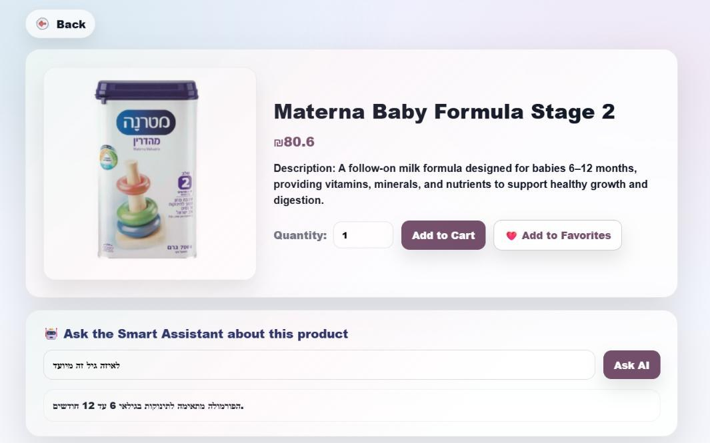
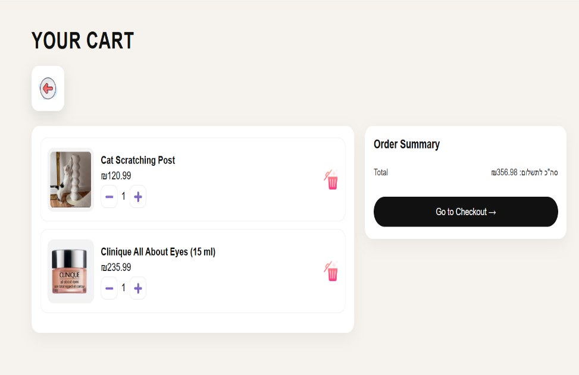
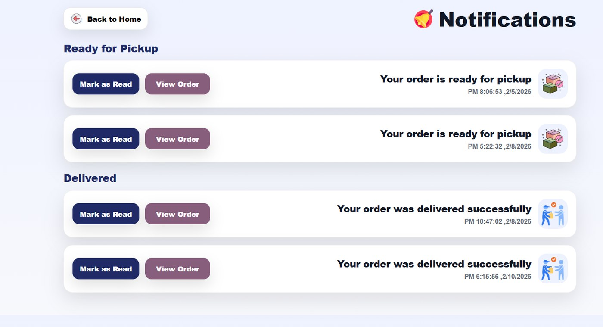
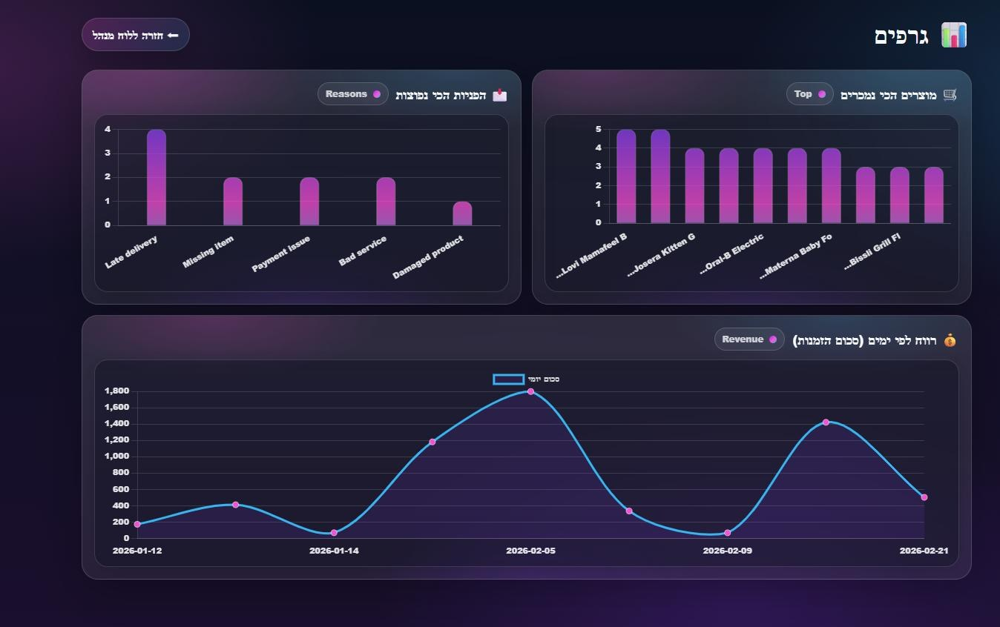
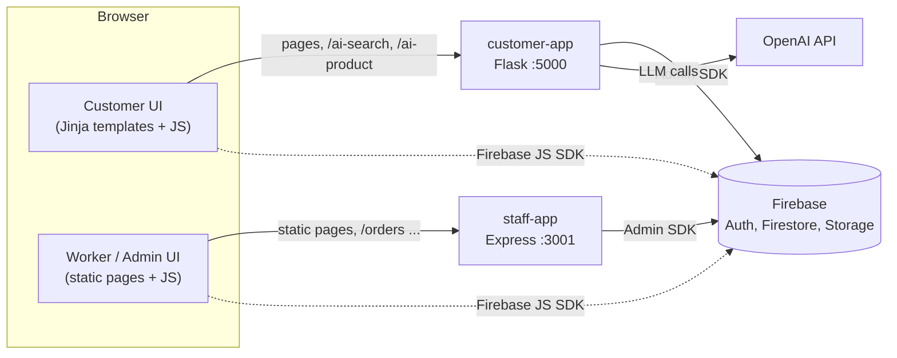

# Smart Market

An AI-assisted online store with three kinds of users (**customers**, **warehouse workers** and **admins**) on top of a Firebase backend. Built by a team of two for the M.Sc. course *Advanced Methodologies for Software Development* (Software Engineering, Braude College of Engineering).

<p align="center">
  
  
</p>

<!-- Add a link to the demo video here after it has been re-recorded or blurred: the original shows real e-mail addresses and phone numbers. -->

## Features

**Customers** (`customer-app`)
- Sign up, log in and reset the password (Firebase Authentication)
- Browse by category and open product pages
- **AI search:** describe what you are looking for in plain language
- **AI product assistant:** ask a free-text question about the product you are viewing
- Cart, favorites, checkout (simulated payment), order history, and in-app notifications when an order is ready or delivered
- "Contact us" form for requests and complaints

**Workers** (`staff-app`)
- Sign in with a worker account and see orders grouped by status: to pick, ready for pickup, delivered
- Open an order, pick its items, then mark it *ready for pickup* or *delivered*; the customer is notified automatically

**Admins** (`staff-app`)
- Product management: add, edit and delete products, with image upload to Firebase Storage
- Customer-request management (new / handled)
- Analytics dashboard (Chart.js): requests by reason, top products, revenue over time
- Worker account management and role-based access

## How the AI features work

| Feature | Where | What it does |
|---|---|---|
| Smart search | `POST /ai-search` | Reads the product names from Firestore, sends them with the customer's query to OpenAI (`gpt-4.1`) and asks for the names that truly match the intent, as JSON. The server maps them back to product cards. |
| Product assistant | `POST /ai-product` | Sends the product's name and description with the customer's question to OpenAI and returns the answer (in Hebrew, no medical advice). |
| Embeddings (groundwork) | `embed_products.py` | Stores `text-embedding-3-small` vectors for the product descriptions in Firestore. The live search does not use them yet. |

## More screenshots

| | |
|---|---|
| <br>**Cart** | <br>**Order notifications** |
| <br>**Admin dashboard** (Hebrew, right-to-left) | <br>**Analytics** (Chart.js) |

## Architecture



| Area | Technologies |
|---|---|
| Customer app | Python, Flask, Jinja2, JavaScript (ES modules), HTML/CSS |
| Staff app | Node.js, Express 5, JavaScript (ES modules), Chart.js |
| Data and auth | Firebase Authentication, Cloud Firestore, Firebase Storage (JS SDK 12 in the browser, Admin SDK on the servers) |
| AI | OpenAI API: `gpt-4.1` and `text-embedding-3-small` |

## Repository layout

```text
smart-market/
├── customer-app/            Flask app: customer pages and AI endpoints
│   ├── app.py
│   ├── embed_products.py    generates product embeddings
│   ├── check_products.py    quick connectivity check against Firestore
│   ├── templates/  static/
│   └── requirements.txt
├── staff-app/               Express server and the worker/admin pages
│   ├── index.js             order endpoints (list, picked, delivered)
│   ├── firebaseAdmin.js
│   └── public/
└── docs/                    project book (public copy), screenshots, data model
```

## Getting started

**Prerequisites:** Python 3.13 (used in development), Node.js 18+, a Firebase project with *Authentication (Email/Password)*, *Cloud Firestore* and *Storage* enabled, and an OpenAI API key.

### 1. Configure Firebase (once)

1. Register a **Web app** in your Firebase project. Copy `firebase-config.example.js` to `firebase-config.js` in both places and fill in your values:
   - `customer-app/static/`
   - `staff-app/public/`
2. In *Project settings > Service accounts* choose **Generate new private key** and save the file as `serviceAccountKey.json` in **both** `customer-app/` and `staff-app/`.
3. Create the Firestore data described in [docs/DATA_MODEL.md](docs/DATA_MODEL.md) (at least one category with a few products).

> `firebase-config.js` and `serviceAccountKey.json` are git-ignored. Never commit them.

### 2. Run the customer app

```powershell
cd customer-app
python -m venv .venv
.venv\Scripts\Activate.ps1            # macOS/Linux: source .venv/bin/activate
pip install -r requirements.txt
$env:OPENAI_API_KEY = "sk-..."        # macOS/Linux: export OPENAI_API_KEY="sk-..."
python app.py                         # then open http://127.0.0.1:5000
```

Optional: `python embed_products.py` stores embeddings for the product descriptions (uses OpenAI credits).

### 3. Run the staff app

```powershell
cd staff-app
npm install
node index.js                         # http://localhost:3001/worker-login.html
```

The worker and admin pages call the API at `http://localhost:3001`, so open them from that address.

### 4. Create the first worker/admin account

Sign up through the customer app, then edit `users/<uid>` in the Firestore console: set `role` to `worker` (or `admin`) and, for admin access, `admin` to `true`. Admins can create more worker accounts from the admin panel (employee management).

## Documentation and testing

- [`docs/Smart-Market-Project-Book.pdf`](docs/Smart-Market-Project-Book.pdf): requirements, use cases, UML class / activity / sequence diagrams, architecture, database design and the black-box test plan. This is a public copy: the cover page and a few screenshot pages that showed test-account details were removed, so the table of contents page numbers no longer match.
- **Testing:** manual black-box test plan with 33 cases (authentication, browsing, ordering, picking, notifications, customer requests, role-based access); all cases passed at submission. There are no automated tests yet.

## Team

| | Role |
|---|---|
| **Esraa Housen** | Customer web app (sign-up/login, home, categories, product page, cart, favorites, orders, customer requests), AI integration (smart search and product assistant), admin side (product management, customer requests, analytics dashboard, admin permissions) |
| **Laren Abdalah** | Firebase setup and database structure, authentication and basic security rules, worker side (orders, picking, status updates) |
| **Both** | Requirements, system design and UML diagrams, integration testing, black-box test plan, project book, demo |

## Known limitations

This is a course project, not production software.

- **No server-side authorization in the staff app.** The Express endpoints (`/orders`, `/orders/:id/picked`, `/orders/:id/delivered`, `/sync-order`, `/demo-create-order`) are unauthenticated, CORS is open, and the Firebase Admin SDK bypasses Firestore rules. Run it locally only. A production version should verify the Firebase ID token and the user's role on every request.
- **Role checks in the browser are UX guards only.** Real enforcement belongs in Firestore security rules, which are not part of this repository (export yours to `firestore.rules`). Make sure users cannot edit their own `role` or `admin` fields.
- **The AI endpoints are unauthenticated and not rate-limited**, and every call uses OpenAI credits.
- **Checkout is simulated.** No payment provider is integrated.
- **AI search sends the whole list of product names on every request.** Fine for a small catalogue; `embed_products.py` is the first step towards embedding-based retrieval for a larger one.
- `app.run(debug=True)` is for local development only.
- **Staff sign in through the staff app (port 3001).** A worker who logs in through the customer login is redirected to `/worker`, a route the customer app does not have.

## Notes

Product names, brands and promotional images appear for demonstration only; all trademarks belong to their respective owners. No open-source licence has been chosen yet, so all rights remain with the authors.
